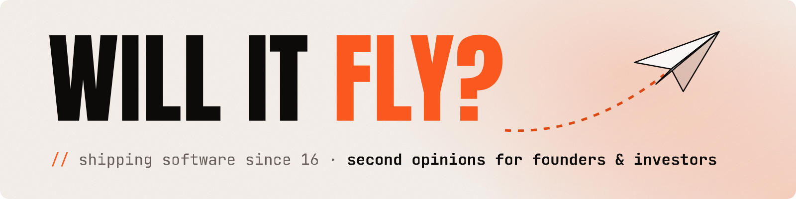

<picture>
  <source media="(prefers-color-scheme: dark)" srcset="assets/banner-dark.svg">
  
</picture>

# Hi, I'm Zvonimir

I've been shipping software since I was 16. These days I split my time between building things and advising startups on the technical side: founders on what to build and how, investors on whether what they're looking at is real.

### Now

- Still working on [IBM VIBE](https://github.com/IBM/VIBE).
- Making **Moravec's Mile**, a video series about chores a five-year-old can do and a robot can barely manage. Episode one is laundry. A startup graveyard episode on Jibo is next.
- Advising founders anywhere between napkin sketch and fundraise, and helping investors check the tech before the money moves.

Last updated October 2026

### Things I've built

- **[IBM VIBE](https://github.com/IBM/VIBE)**: scores AI agent conversations against the expected output, so you catch regressions before your users do. I built it and still work on it.
- **[Carbon Angular](https://github.com/carbon-design-system/carbon-components-angular)**: led the team that shipped Carbon's Angular implementation, and still maintain it
- **[Carbon UI Builder](https://github.com/IBM/carbon-ui-builder)**: a visual builder for Carbon UIs, which I started and open-sourced
- **[alife-web](https://github.com/zvonimirfras/alife-web)**: an artificial life sandbox. Artificial life was my master's thesis, and I'm still not over it.

### Latest videos

<!-- YOUTUBE:START -->
- [Why can&#39;t a robot fold your laundry? | Moravec&#39;s Mile ep. 1](https://www.youtube.com/watch?v=UkDYq0Xirlo)
- [99% or 62%: is one of them lying?](https://www.youtube.com/shorts/KKjqoHO5-sw)
- [Wheels vs legs: who&#39;s winning the laundry robot race?](https://www.youtube.com/shorts/BdPEyaNjCO0)
- [How close is a laundry robot?](https://www.youtube.com/shorts/AxGCaYkGfAc)

<!-- YOUTUBE:END -->

### From the newsletter

<!-- BLOG-POST-LIST:START -->
- [Reflecting on My 2025 AI Predictions: Hits, Misses, and Surprises](https://www.curiositylabz.com/reflecting-on-my-2025-ai-predictions-hits-misses-and-surprises/)
- [New mini-series: future tech that exists today](https://www.curiositylabz.com/new-mini-series-future-tech-that-exists-today/)
- [The 6 Levels of Awareness &lpar;and where you fit&rpar;](https://www.curiositylabz.com/the-6-levels-of-awareness-and-where-you-fit/)
- [Not having a quest is making you stressed. Here&#39;s the science.](https://www.curiositylabz.com/not-having-a-quest-is-making-you-stressed-here-s-the-science/)

<!-- BLOG-POST-LIST:END -->

### Elsewhere

[YouTube](https://www.youtube.com/@ZvonimirFras) · [Z's Curiosity Lab](https://www.curiositylabz.com) · [LinkedIn](https://www.linkedin.com/in/zvonimirfras) · Work with me: [zvonimirfras.com](https://www.zvonimirfras.com)
